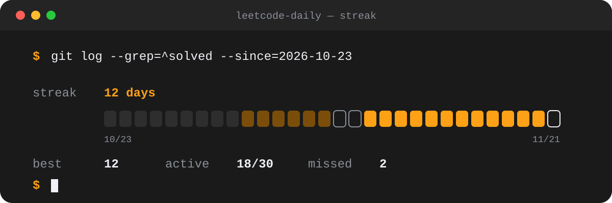

# LeetCode Daily

1일 1리트코드 챌린지 기록 저장소. 하루 한 문제, 복기까지.

- 진행 기록: [`log.md`](log.md)
- 노트: [`notes/patterns.md`](notes/patterns.md) · [`notes/revisit.md`](notes/revisit.md) · [`notes/rules.md`](notes/rules.md)
- 커밋 규칙: `<state>: LC-<id> <title> [Easy|Medium|Hard]` (스트릭은 `solved:` 커밋 기준)
